# Condoku · Condominium management

> Dues, collections, real double-entry accounting, QR-code gate access and
> technical support, in one system built phone-first. For Spanish-speaking
> Latin America, starting with Venezuela — and ready to adapt to other
> countries without issue.

**Status:** actively being built, available for guided demos ·
**Proprietary system** by Kusarive Solutions LLC ·
[Versión en español](README.md) ·
[Showcase page](https://rjblancos.github.io/condoku-showcase/) ·
**[Download the presentation (PDF, in Spanish)](presentacion/Condoku-presentacion.pdf)** (18 slides)

---

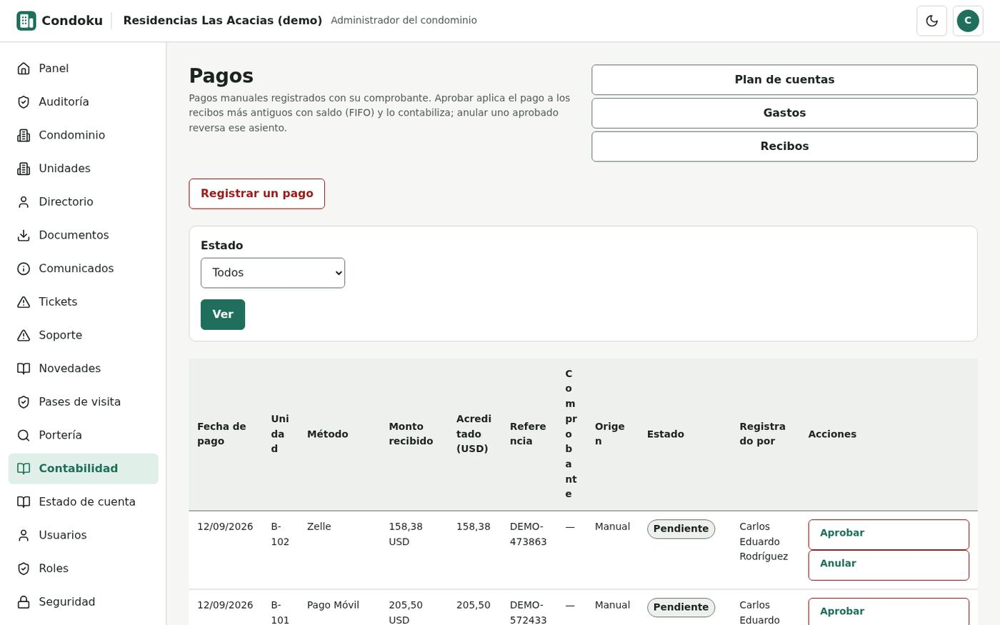

*The administrator approves or voids a payment in seconds. Test data; the
interface is in Spanish.*

## What it solves

Managing a condominium today is a puzzle: spreadsheets only their author
understands, payment proofs that get lost in a WhatsApp chat, a dollar
exchange rate that changes daily and nobody records, and a paper logbook at
the gate that nobody can check from home. The result: owners who don't know
what they owe, and a board that doesn't trust books only the administrator can
review.

Condoku brings collections, accounting, communication and gate access into
one platform: every action is recorded, every figure can be audited, and
every person sees exactly what they're entitled to.

## What it does

- **Collections by proof of payment or online.** The owner uploads their
  proof (cash, transfer, local mobile payment or a dollar wire) and the administrator
  approves it with one click. The payment is applied automatically to the
  oldest outstanding invoices (FIFO), the balance updates itself, and there's
  a notification at every step.
- **Real double-entry accounting.** A general journal, ledger and trial
  balance, with an accounting entry behind every payment, expense and
  invoice — never a spreadsheet in disguise. An approved entry is corrected
  with a reversing entry, never by editing the original: the history stays
  complete. Expenses (payroll, utilities, maintenance) are drafted and
  approved before they affect anyone's dues.
- **Dollars and local currency on every receipt.** The day's exchange rate is
  stored at the moment of each transaction, so a receipt from months ago
  still shows exactly what it was worth then, with nothing to recalculate.
  The same mechanism adapts to each country's currency and official rate
  source.
- **QR-code gate access.** A visitor pass is generated from the owner's
  phone and validated at the gate by scanning the code or typing a short
  backup code; entry and exit are both logged, within a valid time window.
  If someone arrives without a pass, the resident gets a notification to
  approve or reject the visit.
- **Tickets and logbook with follow-through.** Tickets with category,
  priority and status so a resident can report an issue and track it to
  resolution, plus a shift logbook for front-desk and security staff, with
  automatic notification when severity is high.
- **Documents and notices with tiered visibility.** Bylaws, meeting minutes,
  financial statements and notices in one place, each visible only to
  administration, the board, owners or every resident as it should be —
  never a board document visible to anyone by mistake. A new notice alerts
  whoever can see it, with nobody having to check whether something's new.
- **Towers, units and residents always up to date.** Apartments, commercial
  units and parking spots organized by tower, with each unit's share
  calculated proportional to area — never a flat 1/N split. A tenant who
  moved out stops appearing on their own; while the lease lasts, it's the
  tenant who sees the account statement and pays.
- **One account for a whole portfolio.** A management company running
  several condominiums onboards its team from one place and switches between
  condominiums without logging out. Roles that handle money or data across
  multiple condominiums require a one-time second code.
- **Technical support with time commitments.** Four severity levels, from a
  one-hour first response for the most urgent cases to 24 hours for what can
  wait, with the clock paused while waiting on the customer — never "at some
  point."
- **One role per person.** Administrator, accountant, board member, owner,
  tenant, front-desk staff, security guard and more: everyone signs in with
  their own account and sees only their own condominium's data.

## Screenshots

| Collections | Account statement |
|---|---|
|  | 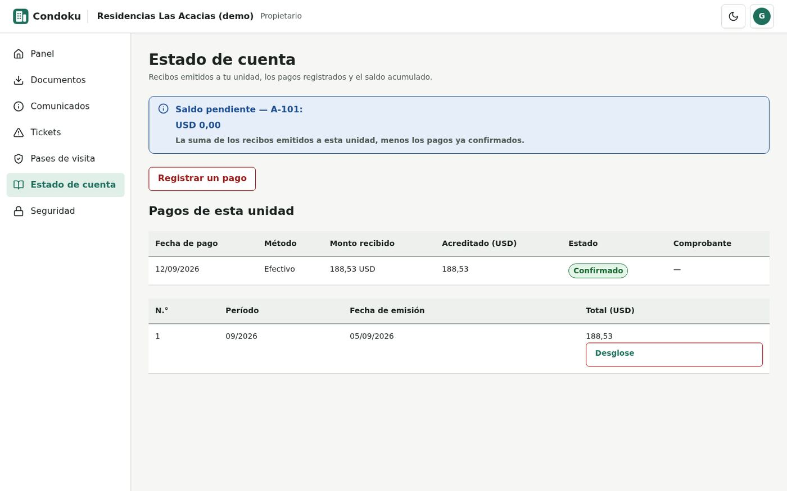 |

| Trial balance | Aging / delinquency |
|---|---|
| 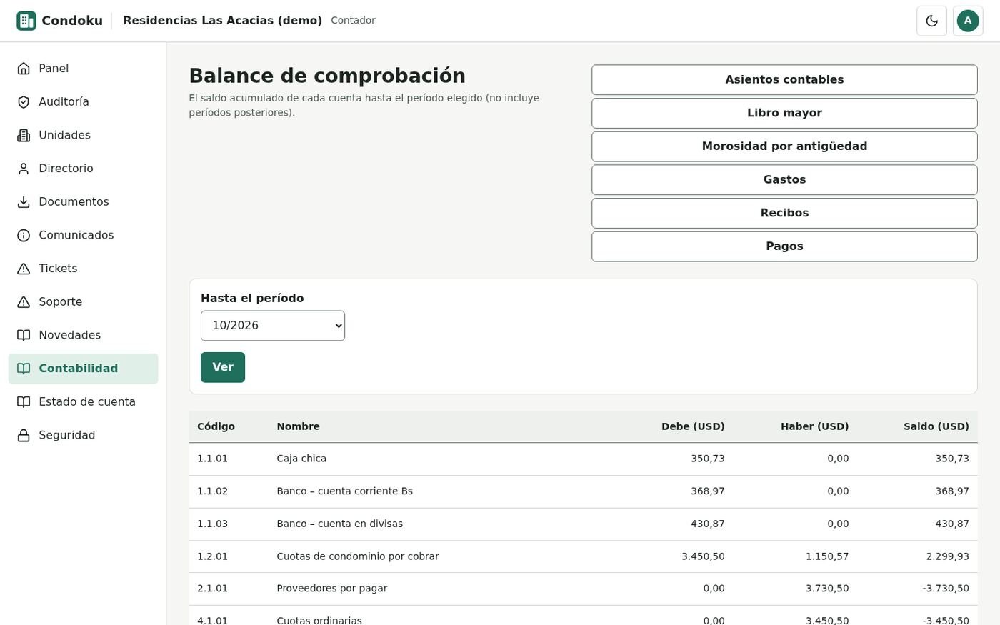 | 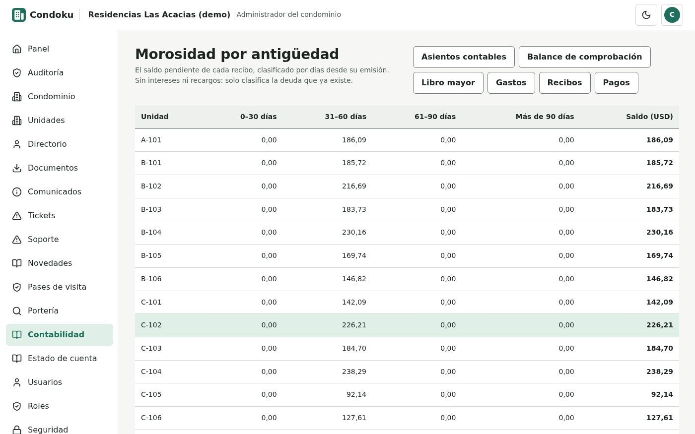 |

| Exchange rate | Gate access |
|---|---|
| 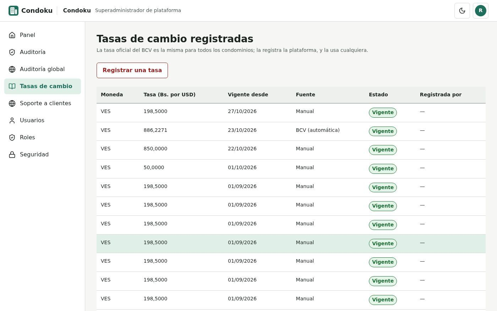 | 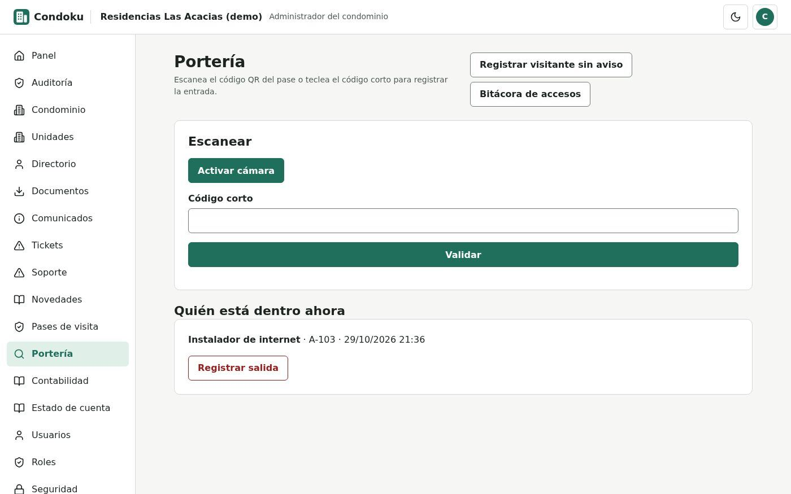 |

| Visitor passes | Tickets |
|---|---|
| 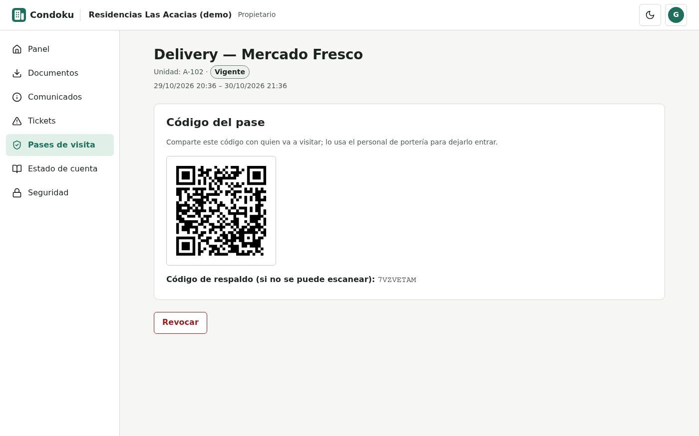 | 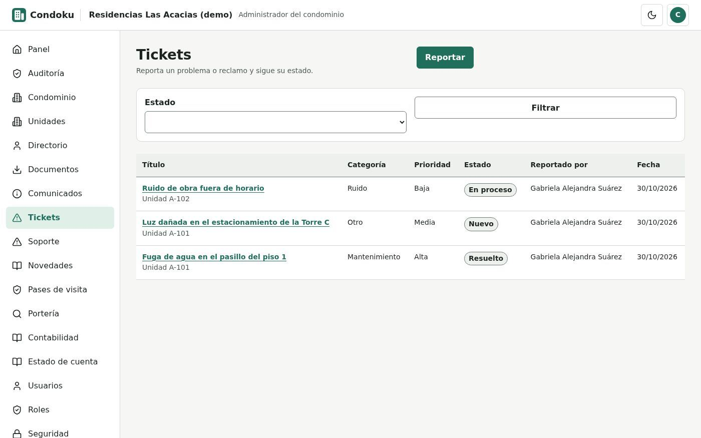 |

| Logbook | Units |
|---|---|
| 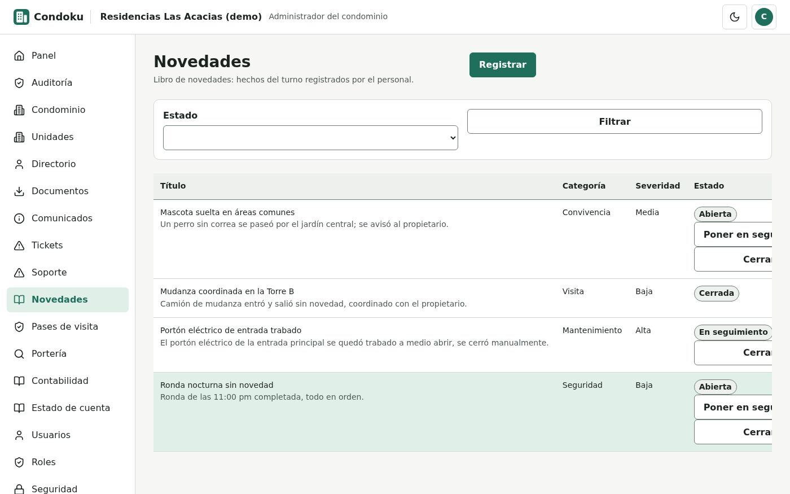 | 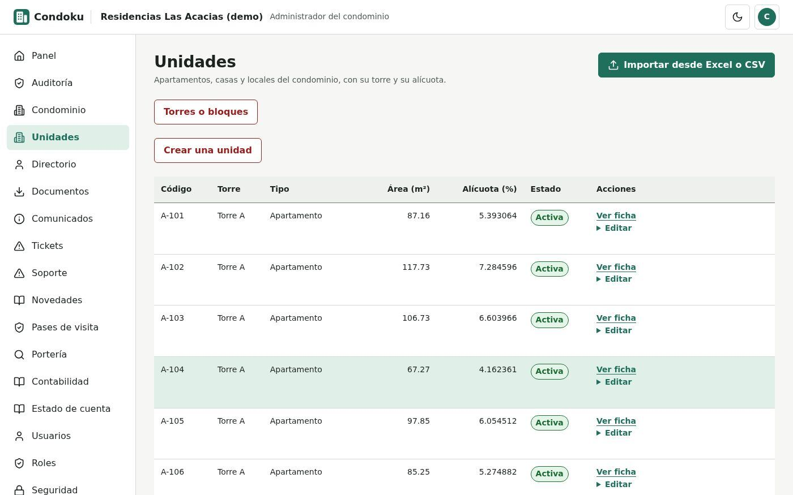 |

| Directory | Management company users |
|---|---|
| 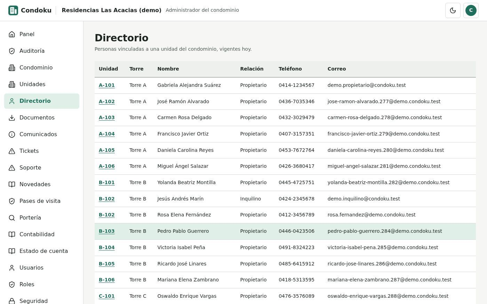 | 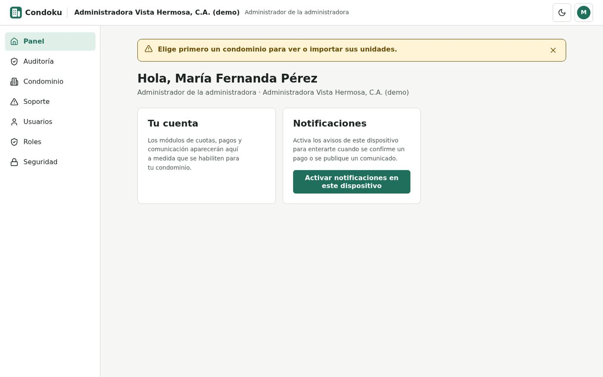 |

| Documents | Notices |
|---|---|
| 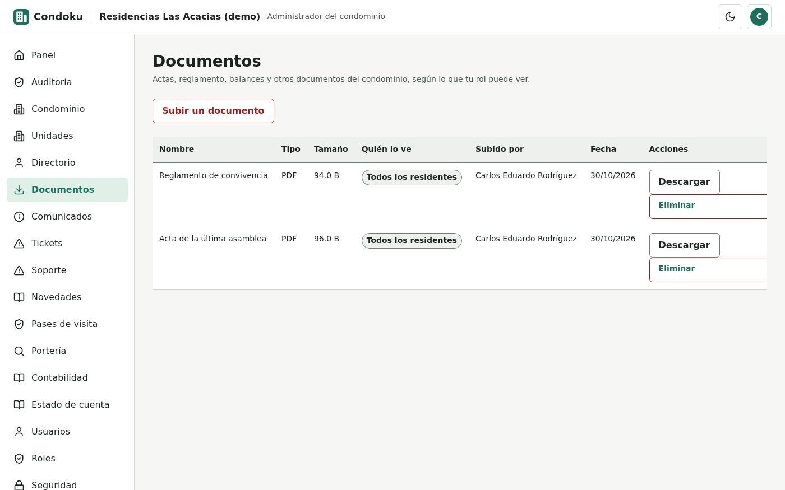 | 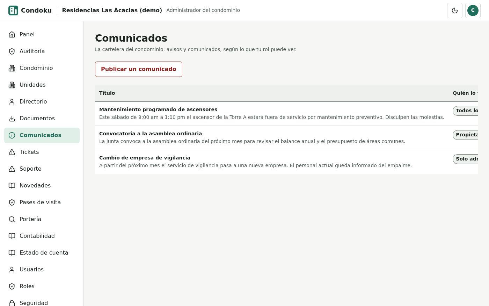 |

Test environment with made-up condominiums, towers, units and residents; the
interface is in Spanish.

## Roles

| Role | What they do |
|---|---|
| Administrator | Condominium, collections, accounting, users and notices. |
| Accountant | Journal, ledger, trial balance and expenses. |
| Board member | Reviews their condominium's books and logbook, read-only. |
| Management company | Runs several condominiums from one account. |
| Platform superadministrator | Exchange rates and overall settings. |
| Platform support | Handles every customer's cases from one centralized queue. |
| Owner | Their account statement, payments and visitor passes. |
| Tenant | Their unit's account statement for the duration of the lease. |
| Front-desk staff | Their shift's logbook. |
| Security guard | Validates visitor passes and sees who is on site right now. |

Everyone signs in with their own account and sees only their own
condominium's data.

## Technical guarantees

| Area | What the system guarantees |
|---|---|
| **Real multi-condominium isolation** | A management company running several condominiums handles them from one account, but one condominium's data never mixes with another's. |
| **Two-factor access** | Anyone handling money or data across multiple condominiums needs a one-time second code to sign in, on top of their password. |
| **A log nobody can erase** | Every important action (an approved payment, a recorded expense, a permission change) lands in an insert-only table: not even an administrator can edit it afterwards. |
| **Accounting that is never rewritten** | A posted entry is corrected with a reversing entry, never by editing the original. |
| **Granular permissions** | 54 independent permissions: every screen requires its own, not a blanket "administrator sees everything." |
| **Quality** | 2,487 automated tests verify isolation, permissions and accounting calculations before any change reaches production. |

## Built with

| Language | Where |
|---|---|
| **PHP** | Logic: collections, accounting, gate access, permissions and multi-condominium isolation |
| **PHP (templates)** | The screens, designed phone-first |
| **SQL** | Multi-condominium storage |

GitHub's language bar only measures the files in this repository, which is
documentation.

## In numbers

- **2,487 automated tests**, zero failures.
- **14 roadmap epics** built and audited.
- **11 user roles**, each with its own screens.
- **54 granular permissions.**

## Ready to put your condominium's books in order?

We'll show you the system live, with a test condominium set up for your case:
how many condominiums you manage and what weighs on you most today —
collections, accounting or gate access.

- Web: [condoku.com](https://condoku.com)
- Email: [info@condoku.com](mailto:info@condoku.com)
- Presentation: [18-slide PDF, in Spanish](presentacion/Condoku-presentacion.pdf)

## What's new

- **30-Oct-2026** · Documents and notices with tiered visibility by role (bylaws, meeting minutes, financial statements and notices).
- **29-Oct-2026** · Showcase published, with a downloadable PDF presentation.

Full log: [CHANGELOG.md](CHANGELOG.md).

© 2026 Kusarive Solutions LLC. See [LICENSE](LICENSE).
